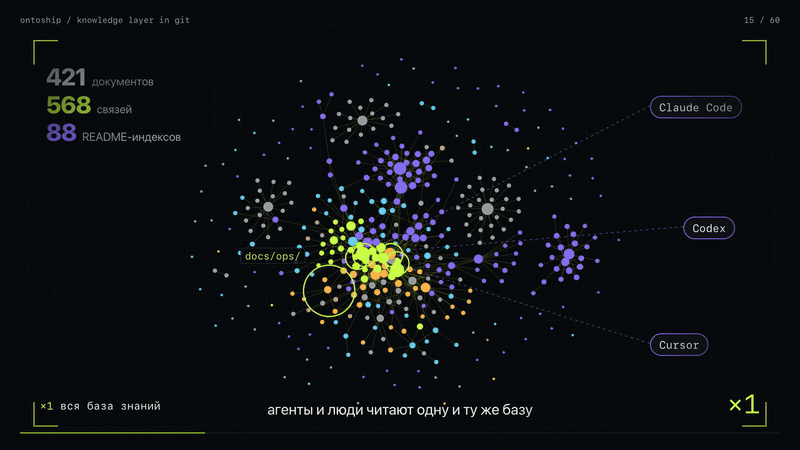
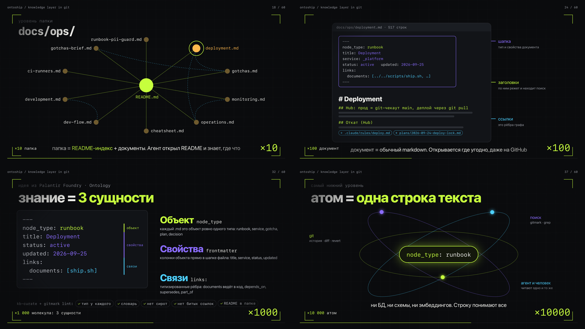
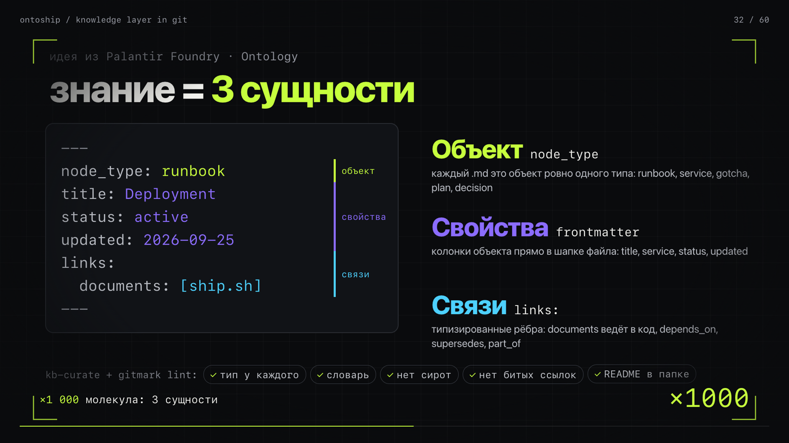

# OntoShip

> **A project knowledge base is just `markdown` + a `README` index + `git`.** Search, the
> link graph and the checks are all built from those files.



▶ [Watch the full 60-second video](docs/media/ontoship-microscope.mp4): from the whole
knowledge base down to a single line of text and back.


*Above: the documentation graph of a live production project
([hub.neuraldeep.ru](https://hub.neuraldeep.ru/)), generated by `gitmark map` with gravity
mode on. Colors are services. The team reads and edits this KB every day.*

On that project today: **421** markdown docs, **568** links between them, **88** `README`
indexes, **617** commits to the KB since March 2026. `gitmark index` rebuilds the whole
thing in **1.5 s** with ~50 MB of RAM.

---

## The idea

Markdown is the source of truth. You and your AI assistant read it directly, in any
editor. Everything derived from it (the search index, this HTML overview, the link graph)
is regenerated from the md, so git stays clean. No service, no database, no embeddings,
no vendor. The entry point is `AGENTS.md`, which every agent reads; `CLAUDE.md` just
imports it with `@AGENTS.md`. Every folder's `README.md` is its index.

```
AGENTS.md                  ← entry point: header, rules, short tree of /docs
CLAUDE.md                  ← one line: @AGENTS.md
/docs
  README.md                ← master index
  /services
    /<service>
      README.md            ← always the folder index
```

We have built this way with AI assistants for months. Agents and people want the same
thing: plain md they can open anywhere, plus fast search so they open the right file
instead of grepping blind.

## Under the microscope

Zoom in on the knowledge base and every level is still something you can open in a text
editor:

| zoom | level | what it is |
|---|---|---|
| ×1 | the whole KB | a graph of md files linked to each other; agents and humans read the same thing |
| ×10 | a folder | a `README.md` index plus the docs it points to |
| ×100 | a document | plain markdown: a small frontmatter header, headings, links |
| ×1 000 | the header | three entities: object, properties, links (see the ontology below) |
| ×10 000 | the atom | one line of text, e.g. `node_type: runbook`. git diffs it, `gitmark`/`grep` find it, an agent reads it |



No layer underneath needs a database, a schema or embeddings.

## What's in here

**`gitmark`** is one self-contained Python-stdlib CLI with zero dependencies:

| command | what |
|---|---|
| `index` | build a SQLite **FTS5** index of sections + frontmatter (title, description, tags, type, status, trust) and typed links |
| `search` | ranked per file: section bm25 + title/description bm25 + trigram substring + fuzzy (typos, Russian morphology), fused with RRF; `--type/--status/--service` filters; `--json` |
| `query` | structured questions over frontmatter, straight from md: `query type=decision status!=deprecated`, `query type=plan --count-by service`, `query trust=unverified 'generated.by~claude'` |
| `map` | self-contained **HTML**: collapsible tree + rendered markdown + a force/radial **graph** of links |
| `serve` | tiny local HTTP server to view the map |
| `stat` | index/KB stats |
| `lint` | *(optional)* ontology checks I1–I9: frontmatter, vocabularies, orphans, broken links, typed links to missing code, past `stale_after`, entry point (`AGENTS.md` + `@AGENTS.md`) |
| `lint --baseline <ref>` | ratchet for a KB with debt: fails only if there are **more** findings than in `<ref>` |
| `toc [--write]` | indexes that are **built, not written**: the `<!-- gitmark:toc -->` block of a folder README is rebuilt from the docs' `title`/`description` |
| `secrets [files…]` | tokens, keys, passwords in the KB, value masked; exit 1 when found |
| `attrs [--write]` | `.gitattributes` with `merge=union` for README indexes, so parallel branches never conflict on them |
| `health` | KB scorecard: typed %, description %, typed links, orphans, trust tiers, stale, duplicate docs |
| `version` | — |

OntoShip ships the **`gitmark`** plugin (KB + dev-flow) as a Claude Code marketplace:
three skills and five commands.

| skill | what |
|---|---|
| `kb-search` | search the KB (FTS5) instead of grepping blind |
| `kb-curate` | light ontology rules when adding/editing docs (types, frontmatter, typed links) |
| `dev-flow` | the spec-driven loop to ship a feature: research → tasks → goal → **spec (md via `kb-curate`)** → isolated **git worktree** → implement → tests → independent review → dev-tests → prod-tests → ship (MR → `dev` → `main`). Feature to prod in ~40 min – 2 h. |

| command | what |
|---|---|
| `/kb` | search the KB (FTS5) and answer from the top hits |
| `/kb-map` | build the self-contained HTML graph of the KB and open it |
| `/doc` | compose/update **one** KB doc following the ontology (wraps `kb-curate`) |
| `/onto-doc` | build the **whole** KB: fans out kb-curate curator agents per area, then lint + index + map |
| `/ship` | run the dev-flow on a feature/fix: research → … → ship (MR → dev → main) |

### What to write after a command

The argument after the command is the prompt. The more specific it is, the better the result.

**`/kb <query>`**: a topic, symbol, concept or question to find in the KB.
- Good: `/kb how is the billing webhook signature verified`, `/kb tier rate limits`, `/kb sandbox isolation`.
- Use concrete nouns, not full sentences. Cyrillic, typos and substrings are fine (trigram/fuzzy).
- Bare `/kb` prints index stats and the syntax.

**`/kb-map [output-path]`**: usually nothing (defaults to `docs-map.html`).
- Optional path: `/kb-map build/graph.html`.

**`/doc <topic / what to document>`**: name the thing to write up. The agent picks the
node_type and folder, writes frontmatter + typed links, and indexes it.
- Good: `/doc how the billing webhook verifies the YooKassa signature`, `/doc decision: drop Firecracker-per-session`.
- It searches first and edits an existing doc instead of creating a duplicate.

**`/onto-doc [scope]`**: bootstrap or rebuild the entire KB. Empty means the whole repo, or
give it a scope (`/onto-doc services/api services/billing`, `/onto-doc only reference docs`).
- Surveys the codebase, splits it into doc areas and dispatches one curator agent per area
  in parallel, then lints, reindexes and regenerates the graph.
- Use it on a fresh repo to stand up docs/ from nothing, or to backfill coverage.

**`/ship <what + why + done>`**: describe the change as fully as you can, the dev-flow is
only as good as this description. Say what to do, why (the goal) and the done-criteria,
and name the target service or file if you know it.
- Good: `/ship add a 60 rpm rate-limit to /api/search; goal: stop abuse; done = HTTP 429 over the limit + a unit test + a note in docs/reference/limits.md`.
- Weak: `/ship fix search`. The agent has to guess the goal and the done-criteria.
- Add "deploy it" or "don't deploy" if you want to control the last step.

> **Looking for `destructive-guard`?** The `PreToolUse` safety hook that intercepts
> destructive commands (`rm -rf`, `git reset --hard`, `terraform destroy`, `DROP TABLE`…)
> and turns them into a y/n confirmation now lives in its own repo:
> **[github.com/vakovalskii/destructive-guard](https://github.com/vakovalskii/destructive-guard)**
> · [landing + rules reference](https://vakovalskii.github.io/destructive-guard/).

## Quickstart

```bash
python3 skills/kb-search/gitmark.py index            # build .gitmark/index.db
python3 skills/kb-search/gitmark.py search "auth flow"
python3 skills/kb-search/gitmark.py map -o docs-map.html && open docs-map.html
```

Pure `python3` (≥3.7) with SQLite **FTS5**. The **trigram** tokenizer (SQLite ≥ 3.34) adds
fuzzy, substring and non-Latin matching; it is detected automatically, and search still
works without it. Add `.gitmark/` to `.gitignore`, it's a build artifact.

## Install as a Claude Code plugin

```text
/plugin marketplace add vakovalskii/ontoship
/plugin install gitmark@ontoship
```

Or copy `skills/` and `commands/` into your repo's `.claude/`. That keeps it project-local,
no marketplace needed.

## Optional: the ontology

The core needs no frontmatter at all: `index`/`search`/`map` work on raw markdown. If a
team wants the KB to stay in shape as it grows, there's a light code ontology (inspired by
[Palantir's Ontology](https://www.palantir.com/docs/foundry/ontology/overview)). Each doc
gets a `node_type`, a few frontmatter properties and typed links, and `gitmark lint`
checks them (no broken links, no orphans, every folder has a README index).
See [`docs/ontology.md`](docs/ontology.md). The tool works the same if you skip it.

The frontmatter is compatible with Google's [Open Knowledge Format](https://github.com/GoogleCloudPlatform/knowledge-catalog/blob/main/okf/SPEC.md):
`type` works as `node_type`, and `description`, `generated`/`verified` (trust tier) and
`stale_after` are understood by search, `query` and `lint`. On a 198-question benchmark
over seven real project KBs, gitmark 0.2 puts the right doc first 69% of the time
(grep: 30%, 0.1: 47%). A one-line `description` on each doc lifts it further,
see [docs/decisions/okf-alignment.md](docs/decisions/okf-alignment.md) and [`bench/`](bench/README.md).

Palantir models an organization as objects, their properties and the links between them.
OntoShip takes the same three entities and applies them to knowledge about code:

| Palantir Ontology | in OntoShip | example |
|---|---|---|
| **Object** (object type) | `node_type`: every `.md` is one object of one type | `runbook`, `service`, `gotcha`, `plan`, `decision`, `reference` |
| **Properties** | YAML frontmatter, the object's columns | `title`, `service`, `status`, `updated`, `tags` |
| **Links** (link types) | typed links under `links:`, including links into code | `documents`, `depends_on`, `supersedes`, `part_of` |

The `kb-curate` skill holds the rules for writing them; `gitmark lint` checks the invariants
(every doc has a type, values come from the vocabulary, no orphans, no broken links, every
folder has a README, a superseded doc is marked deprecated).



## Why not a wiki, Notion or vector-DB memory

You already read md and already use git. The CLI is one stdlib Python file you can read in
an afternoon. It works offline and sends nothing to a SaaS. There are plenty of memory
tools that are a service to run; this one is a few files in your repo, and the graph above
shows it on a real product.

## License

MIT, see [LICENSE](LICENSE).
